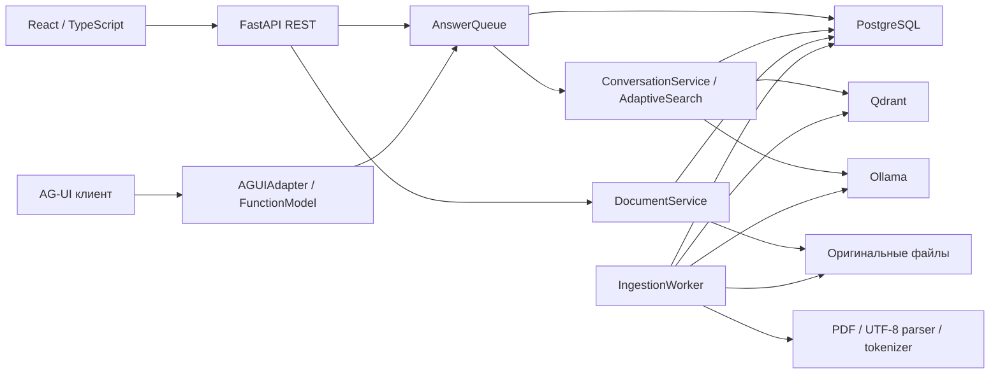

# Архитектура RAGumentation

Описание текущей реализации на 13 октября 2026 года. Настройки приведены по умолчанию; полный справочник - [configuration.md](configuration.md)

## Компоненты и зависимости

PostgreSQL является источником истины: владельцы, проекты, файлы, chunks, переписка, очередь ответов и состояние индексации. Qdrant - производный индекс; найденные UUID повторно проверяются через SQL. Файлы хранятся отдельно от БД

Обычный GUI использует REST-очередь и polling. AG-UI - отдельная интеграция с той же очередью. Она не запускает второй RAG pipeline и не заменяет серверную историю клиентским transcript

| Слой | Реализация | Ответственность |
| --- | --- | --- |
| Domain | [entities](../src/study_rag/domain/entities.py), [ports](../src/study_rag/domain/ports.py), [errors](../src/study_rag/domain/errors.py) | Immutable dataclasses, Protocol, доменные ошибки |
| Application | [application](../src/study_rag/application) | Авторизация, проекты, документы, поиск, очередь, сценарий ответа |
| Adapters | [adapters](../src/study_rag/adapters) | PostgreSQL, Qdrant, файлы, parser/tokenizer, модели, безопасность |
| HTTP | [routes](../src/study_rag/api/routes.py), [schemas](../src/study_rag/api/schemas.py), [ag_ui](../src/study_rag/api/ag_ui.py) | Валидация, Bearer, сериализация и транспорт |
| Composition | [bootstrap](../src/study_rag/bootstrap.py), [main](../src/study_rag/main.py) | Создание ресурсов и lifespan |
| Browser | [frontend/src](../frontend/src) | Интерфейс, REST, темы, Markdown/KaTeX, PDF |

Domain не зависит от FastAPI/ORM. Внешние DTO - Pydantic, внутренние записи - dataclasses с именованными полями, slots и frozen. Сценарии получают зависимости явно; клиент Ollama и SQL-запросы не создаются внутри HTTP routes

## Данные и изоляция

| Таблица | Назначение |
| --- | --- |
| `user_accounts` | Логин, Argon2 hash, дата создания |
| `projects` | Владелец, название, timestamps, deleted_at |
| `documents` | Проект/владелец, имя, тип, storage key, SHA-256, profile, состояние, прогресс, ошибки и lease |
| `document_chunks` | Текст, ordinal, token count, страницы, документ/владелец |
| `chat_sessions` | Проект/владелец, название, automatic_title, deleted_at |
| `chat_turns` | Request UUID, статус, queued_at, lease, ошибка |
| `chat_messages` | User/assistant текст, snapshots цитат, sufficient_context, response_duration_ms |

Точная схема и ограничения: [database.py](../src/study_rag/adapters/database.py). UTC timestamps содержат timezone. Составные ключи/FK не допускают связывание объектов разных владельцев

JWT проверяется по HS256, `sub/exp/iat/iss/aud`; затем проверяется существование аккаунта. Клиент не задаёт tenant ID. Аккаунт из JWT определяет все SQL/vector/file операции. Чужой UUID пользовательского объекта даёт 404

Проекты - логические пространства в общей PostgreSQL. Поиск получает ready ID документов только для tenant/project/активного profile, передаёт allowlist в Qdrant и повторно проверяет chunks/документы в SQL. Сам индекс не хранит project ID: изоляция проекта основана на разрешённом списке документов и SQL-проверке

Deduplication ограничена `(tenant, project, SHA-256, embedding_profile)` среди не deleted документов. Уникальный частичный индекс защищает от параллельной одинаковой загрузки; лишний файл проигравшей регистрации удаляется. Удаляемая запись ещё участвует в dedup до состояния deleted

## Миграции и совместимость

| Revision | Изменение |
| --- | --- |
| 4f6c7fea6768 | Исходные tenant-owned документы, chunks и переписка |
| 92c2c394c585 | Dedup с учётом embedding profile |
| b7e3a12d904f | Проекты и назначение старых файлов/чатов default project |
| c8f4b23e015a | Deleted_at проектов/чатов и automatic_title |
| d9a5c34f126b | Сохранение indexed_chunk_count |
| e0b6d45a237c | Nullable response_duration_ms |
| f1c7e56b348d | Durable очередь ответов, queued и queued_at |

Текущая обязательная revision - f1c7e56b348d. Логин в ORM/API называется login_name, но физическая колонка user_accounts.email_address сохранена: отдельной миграции переименования нет. Старые логины-почты продолжают работать

Rebuild PDF, новая тема, адаптивный поиск и frontend labels сами по себе не добавляют SQL-миграций. Startup сравнивает revision и проверяет ожидаемые колонки, не пытаясь исправить схему автоматически

## Загрузка, индексация и публикация

1. Middleware ограничивает HTTP body до размера файла + 64 KiB multipart overhead, включая поток без Content-Length
2. Route читает файл ограниченными частями, сервис проверяет расширение/имя/содержимое
3. Storage атомарно сохраняет файл под сгенерированным ключом `tenant/document/random.upload`
4. Репозиторий регистрирует queued документ, API отвечает 202
5. IngestionWorker извлекает текст, разбивает его, заменяет SQL chunks, удаляет прежние vectors этого документа
6. Пакеты по 16 chunks получают embeddings и записываются в Qdrant; после каждого успешного upsert сохраняется прогресс
7. Документ становится ready только после всех пакетов и проверки lease

Очередь индексации - таблица documents. Claim использует короткую транзакцию `FOR UPDATE SKIP LOCKED`, lease 120 с и heartbeat 30 с. Долгое извлечение/инференс не удерживает SQL-транзакцию. После аварии истёкший indexing lease позволяет начать заново

Chunk UUID детерминирован по документу/profile/ordinal. Публикация ready отделена от физической записи: частичные chunks/vectors исключаются из поиска SQL-фильтром. Транзакции PostgreSQL, файловой системы и Qdrant не являются общей атомарной транзакцией

Прогресс - успешно записанные chunks / общее число. До ready максимум 99%, после ready 100%. Claim/retry сбрасывает счётчик; failed сохраняет достигнутое значение. Подробнее: [PDF и документы](pdf-sources.md)

Удаление ставит deleting и отзывает lease, сразу исключая документ из поиска. Worker удаляет vectors, оригинал и SQL chunks, затем ставит deleted. Ошибка очистки сохраняет deleting и откладывает следующую попытку с backoff до 300 с

## Модели и поиск

По умолчанию embeddings и генерация используют Ollama, tokenizer - публичный HF Qwen. Optional HF embeddings используют отдельный Gemma tokenizer. Векторы 768-мерные, конечные, ненулевые и L2-нормализованные

На embedding profile создаётся коллекция `study_rag_` + первые 32 hex-символа SHA-256(profile), distance COSINE. Payload содержит tenant/document/chunk/profile. Настройки существующей коллекции проверяются, несовместимая коллекция автоматически не пересоздаётся

Адаптивный поиск планирует focused/comparison/overview/expansion по вопросу и завершённой истории. Векторная ветка применяет порог, обзорная читает SQL-тексты для отбора оглавления и разных разделов. Обзор использует цитаты, отдельную проверку смысла и синонимов; конечный список собирается кодом из проверенных пунктов

Нет независимого semantic index сущностей, постоянного кеша обзоров или гарантии полноты. Подробности: [adaptive-search.md](adaptive-search.md), [local-models.md](local-models.md)

## Ответ, очередь и сохранение

Все production HTTP-вопросы проходят AnswerQueue. В PostgreSQL хранится FIFO по queued_at/UUID с одним глобальным pending-слотом. В одном чате допускается один активный turn. Приём вопроса и выполнение отделены от HTTP-наблюдения

ConversationService получает проект из сохранённого чата и последние completed сообщения (до 8). Короткие поддержанные приветствия/вопросы о помощнике обходят поиск. Содержательные вопросы получают контекст; при недостаточном evidence возможен дополнительный отбор, затем общий ответ без citations с явной пометкой

Генератор валидирует JSON, завершение Ollama, source labels и соответствие inline markers. При length ответ генерируется заново один раз с увеличенным лимитом; частичный JSON не сохраняется. Ответ и snapshots цитат публикуются вместе с завершением turn одной транзакцией

Время обработки измеряется monotonic clock после выхода из очереди до финальной записи. История сохраняет текст и snapshots, не полный оригинал источника. Удаление документа не стирает старый ответ; удаление чата/проекта стирает относящуюся к нему переписку

Остановка, replay, аварии и очередь: [answer-queue.md](answer-queue.md). API и статусы: [contracts.md](contracts.md)

## Lifecycle и эксплуатация

Lifespan проверяет PostgreSQL и точную Alembic revision, инициализирует tokenizer/embedding/vector/generation adapters, создаёт сервисы и запускает ingestion worker и answer worker. Миграции выполняются отдельно, таблицы автоматически не создаются

Shutdown отменяет и ожидает workers, затем закрывает clients/models и SQL engine. Активный ответ получает answer_cancelled при штатной отмене; queued остаются. Индексация восстанавливается по lease. Health проверяет состояние обоих workers и readiness БД/Qdrant/моделей, но не выполняет тестовую генерацию

Embedded Qdrant сериализует операции и требует один процесс. HTTP Ollama сериализован отдельно внутри generation и embedding transport; индексация и ответ могут идти одновременно. Глобальная очередь ответов не означает полной сериализации всех обращений к Ollama

Определённые таймауты, размерные лимиты и one-worker запуск подходят локальному приложению. Горизонтальная production-схема, облачный adapter, OCR и метрики качества не реализованы
